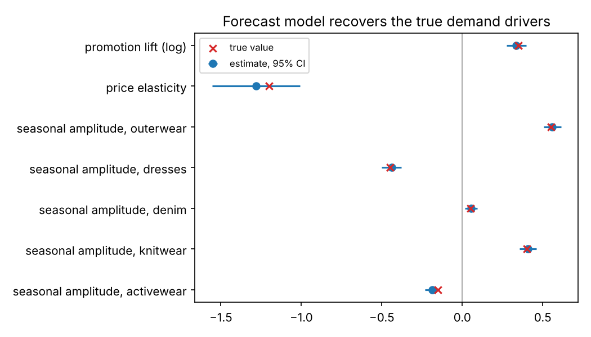
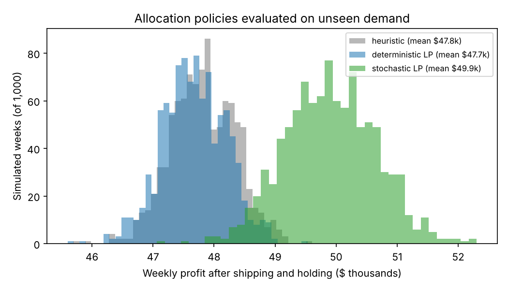
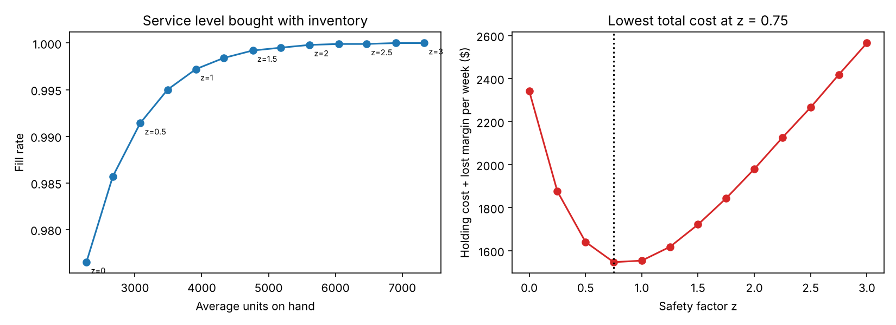

# Inventory allocation and fulfillment: forecasting, optimization, and simulation

Where should next week's inventory sit so that each order ships quickly and cheaply, and what does the answer gain over a sensible rule of thumb? This project works through that question for a fictional apparel retailer with four fulfillment centers serving twelve client regions and 60 styles. It combines an explainable demand forecast, three allocation policies including a stochastic linear program, a Monte Carlo evaluation on demand none of the policies has seen, and a simulation of replenishment policies that trades service level against inventory.

All data are simulated (`src/simulate.py`) from a demand process with known coefficients, so the forecast can be checked against the truth and every policy can be judged on outcomes rather than on its own objective.

## Results in brief

| Question | Answer |
| --- | --- |
| How accurate is an explainable forecast? | The Poisson GLM reaches a weighted absolute percentage error of 43.4% on eight held-out weeks, against 43.2% for the true simulated mean (the noise floor of weekly Poisson demand at this volume) and 55% to 56% for 4- and 8-week moving averages, which also over-forecast by 10% to 12% |
| Does it recover the real demand drivers? | Yes: the promotion lift, price elasticity, and all five seasonal amplitudes lie inside their 95% confidence intervals |
| Does optimizing allocation pay? | Only when the optimization accounts for uncertainty. A linear program on the point forecast does no better than a heuristic (−0.3%); a stochastic program over 60 demand scenarios earns $2,080 more per week than the heuristic (+4.3%, 95% CI $2,060 to $2,100) and fills 92.2% of orders instead of 89.9% |
| How much safety stock? | A safety factor of z = 0.75 minimizes holding cost plus lost margin, at a 99.5% fill rate |

## Method

### 1. Forecast

`src/forecast.py` fits a Poisson generalized linear model (statsmodels):

```
log E[units] = style + region + category-specific annual seasonality + promotion + elasticity x log(price ratio)
```

Every coefficient means something a merchandising or finance partner can use: a promotion raises demand by a factor of exp(0.336) = 1.40, a 10% price cut raises it by about 14%, and outerwear peaks in winter while dresses peak in summer. The model is trained on weeks 0 to 25 and tested on weeks 26 to 33.

| Model | WAPE | Bias | Mean Poisson deviance |
| --- | --- | --- | --- |
| Poisson GLM | 0.434 | −1.4% | 1.137 |
| Moving average, 4 weeks | 0.565 | +10.2% | 1.772 |
| Moving average, 8 weeks | 0.555 | +11.8% | 1.652 |
| True simulated mean (oracle) | 0.432 | −0.8% | 1.129 |



### 2. Allocation

`src/allocate.py` decides how many units of each style to place in each fulfillment center before the week begins, subject to each style's supply (5% above its national forecast) and each center's capacity. During the week, each order ships from the cheapest center that still has the style, paying a handling surcharge when it is not the region's nearest center; an order nobody can fill is a lost sale.

1. Heuristic: split each style by its recent demand share in the regions nearest each center, cap at capacity, and spill leftover units into centers with room.
2. Deterministic linear program: maximize margin minus shipping and holding cost using the point forecast.
3. Stochastic linear program: the same objective averaged over 60 demand scenarios drawn from the forecast distribution, with allocation as the first-stage decision and fulfillment as the second (sample average approximation), solved with HiGHS through PuLP.

Each allocation is then evaluated on the same 1,000 weeks of demand drawn from the true process, so differences between policies are paired.

| Policy | Units placed | Mean weekly profit | 5th percentile | Fill rate | Shipping per unit |
| --- | --- | --- | --- | --- | --- |
| Heuristic | 1,900 | $47,822 | $46,975 | 89.9% | $6.52 |
| Deterministic LP | 1,896 | $47,668 | $46,830 | 89.7% | $6.58 |
| Stochastic LP | 2,015 | $49,902 | $48,708 | 92.2% | $6.40 |



The lesson is about uncertainty, not about optimization as such. A plan built on the point forecast places exactly the expected demand where it is expected, so it has no answer to a week in which demand lands somewhere else, and it performs like the rule of thumb. The stochastic program sees the spread of possible weeks, recognizes that a unit placed near likely demand is worth more than its holding cost even when it may not sell, fills each center to capacity, and positions units so that fewer orders ship from distant centers. It came out ahead in every one of the 1,000 simulated weeks.

### 3. Replenishment

`src/reorder_sim.py` simulates a weekly review, order-up-to policy with a two-week lead time over 52 weeks and 200 replications, with demand more variable than Poisson (negative binomial). Raising the safety factor buys fill rate with inventory, and the total of holding cost and lost margin is lowest at z = 0.75.



## Limitations

The network, costs, and demand are simulated and stylized: shipping cost grows with distance on a schematic map, demand is independent across styles, and returns, substitution between styles, and multi-week dynamics in the allocation are left out. The stochastic program's advantage depends on how well the scenarios represent real demand uncertainty, which in practice would come from the forecast's own validated error distribution.

## Repository layout

```
src/simulate.py        network, styles, and 34 weeks of demand from a known Poisson process
src/forecast.py        Poisson GLM, baselines, coefficient recovery, planning-week forecast
src/allocate.py        heuristic, deterministic LP, stochastic LP, Monte Carlo evaluation
src/reorder_sim.py     base-stock replenishment simulation and safety-stock trade-off
src/figures.py         figures
tests/test_pipeline.py constraint, recovery, and conservation checks (pytest)
results/               tables and figures
run_all.sh             rebuilds everything from the seeds
```

## How to run

```
pip install -r requirements.txt
bash run_all.sh
```

The full run takes about a minute and a half.

## Author

Patricia K. Kamanda. Released under the MIT License.
